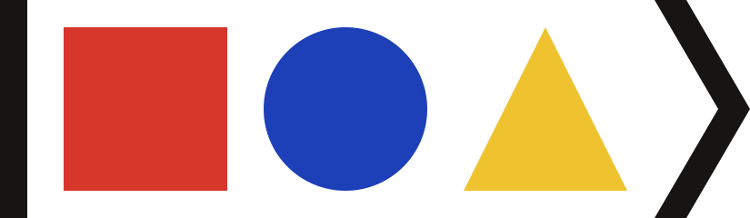
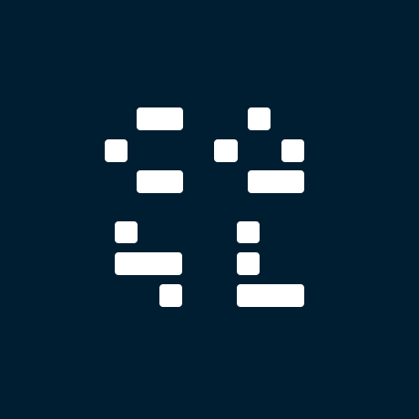
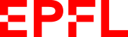

<p></p>

# Ketworks

Ketworks is a community project on neural quantum states, published at **[ketworks.org](https://ketworks.org)**. It has two parts.

- **Ketbook** is a reference on neural quantum states: variational Monte Carlo, optimization, network architectures and benchmark problems. Its pages are Markdown files with LaTeX in [`wiki/`](wiki/).
- **Ketboard** lists variational energies of neural quantum states on benchmark problems that are defined exactly. Each entry is the energy printed in a versioned arXiv paper, with the table or line it comes from. Instances are defined in [`data/benchmarks.json`](data/benchmarks.json), entries are in [`data/results/`](data/results/).

Pages are marked as drafts until a maintainer has reviewed them.

## Contributing

Corrections, new pages and new results are welcome as pull requests. Every page has an *Edit this page* link, and the site has a form that prepares a result file from the printed energy and the arXiv identifier. [CONTRIBUTING.md](CONTRIBUTING.md) explains both, with the editorial rules for pages and the eligibility rules for results.

## Running the site locally

```sh
python3 -m venv .venv && source .venv/bin/activate
pip install -r requirements.txt
npm ci --ignore-scripts
npm test && python -m unittest discover -s tests
python -m nqsbot.build
python -m http.server 8080 --directory dist
```

This needs Python 3.12 and Node.js 22. The build renders LaTeX with KaTeX and writes the site to `dist/`.

## Repository layout

| Path | Contents |
| --- | --- |
| `wiki/` | Ketbook pages; their order and sections are in `wiki/index.json` |
| `data/benchmarks.json` | Ketboard instances: Hamiltonian, cluster, boundaries, couplings, sector |
| `data/results/` | Reviewed Ketboard entries, one file per paper |
| `data/proposals/` | Results for instances not yet defined; never published |
| `site/` | Page templates, styles and scripts |
| `nqsbot/` | Validation, paper metadata from arXiv, and the site build |
| `pages/` | Pages outside Ketbook, such as About |
| `brand/` | The Ketworks mark, avatar and social-preview image; supporter logos in `brand/supporters/` |
| `docs/maintainers.md` | Deployment and repository rules |

## Support

Ketworks is supported by the [Computational Quantum Science Laboratory (CQSL)](https://www.epfl.ch/labs/cqsl/) at [EPFL](https://www.epfl.ch/).

<p>
  <a href="https://www.epfl.ch/labs/cqsl/"></a>
  &nbsp;&nbsp;&nbsp;
  <a href="https://www.epfl.ch/"></a>
</p>

## License

Everything in this repository, the pages and data as well as the code, is released under the [MIT License](LICENSE).
